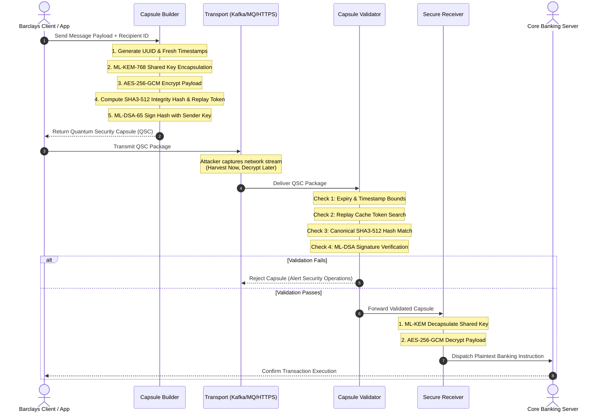

# Document 03: Architectural & Sequence Diagrams

**Barclays Innovation Lab Proposal**  
**Author**: Principal Security Architect, Barclays Innovation Lab  

---

## 9. Architecture Diagram (Text & ASCII)

```
===================================================================================
                       BARCLAYS QUANTUM SECURITY CAPSULE (QSC)
                               ARCHITECTURE OVERVIEW
===================================================================================

[ CLIENT / ORIGINATOR ]
  │
  ├──► [ 1. Payload Creation ] (Raw Banking Instruction / SWIFT / REST API Request)
  │
  ├──► [ 2. Capsule Builder ]
  │      │
  │      ├──► ML-KEM-768 Engine (FIPS 203) ──► Encapsulate Symmetric Key (K)
  │      ├──► AES-256-GCM Engine          ──► Encrypt Payload with K
  │      ├──► SHA3-512 Engine             ──► Generate Integrity Hash & Replay Token
  │      └──► ML-DSA-65 Engine (FIPS 204)  ──► Sign Hash with Sender Private Key
  │
  └──► [ 3. Transmitted QSC Container ]
         │
         │  ( Can travel across ANY Transport: HTTPS, Kafka, MQ, VPN, SWIFT )
         │
         ▼
[ UNTRUSTED NETWORK / HARVEST NOW DECRYPT LATER (HNDL) ADVERSARY ]
  │  - Encrypted Payload: Unreadable without Recipient ML-KEM Private Key
  │  - Signature: Unforgeable without Sender ML-DSA Private Key
  │  - Replay Token: Locked to specific timestamp & unique ID
  │
  ▼
[ SERVER / RECEIVER ]
  │
  ├──► [ 4. Capsule Validator ]
  │      │
  │      ├──► 1. Check Lifetime (Current Time <= ExpiresAt)
  │      ├──► 2. Check Replay Registry (Redis / Cache)
  │      ├──► 3. Re-compute SHA3-512 Canonical Integrity Digest
  │      └──► 4. Verify ML-DSA-65 Signature using Sender Public Key
  │
  ├──► [ 5. Decryption Execution ] (Executed ONLY if ALL Validation checks PASS)
  │      │
  │      ├──► ML-KEM-768 Decapsulate ─────► Recover Symmetric Key (K)
  │      └──► AES-256-GCM Decrypt ────────► Recover Plaintext Payload
  │
  └──► [ 6. Core Banking Engine ] (Executes Wire Transfer / Payment Processing)

===================================================================================
```

---

## 10. Sequence Diagram


