# 03 — Architecture Diagrams

[](https://csrc.nist.gov/projects/post-quantum-cryptography)
[](../tests/)

---

## 1. Complete System Architecture Overview

```
===================================================================================
                   QUANTUM SECURITY CAPSULE (QSC) ARCHITECTURE
===================================================================================

[ ORIGINATING CLIENT / BANKING APPLICATION ]
  │
  ├──► [ 1. Payload Creation ] (ISO 20022 pacs.008 / SWIFT MT103 / Payload Bytes)
  │
  ├──► [ 2. Capsule Builder ] (src/capsule/builder.py)
  │      │
  │      ├──► ML-KEM-768 Engine (src/crypto/kem.py)       ──► Encapsulate Shared Secret (K)
  │      ├──► HKDF-SHA3-512 Engine (src/crypto/kdf.py)     ──► Derive AES Content Key
  │      ├──► AES-256-GCM Engine (src/crypto/symmetric.py) ──► Encrypt Payload (AEAD)
  │      ├──► SHA3-512 Engine (src/crypto/hashing.py)     ──► Generate Replay Token & Integrity Lock
  │      └──► ML-DSA-65 Engine (src/crypto/dsa.py)         ──► Lattice Digital Signature
  │
  └──► [ 3. Transmitted QSC Wire Container ]
         │
         │  ( Transmitted across ANY transport: HTTPS, Kafka, IBM MQ, SWIFT, .qsc Files )
         │
         ▼
[ UNTRUSTED NETWORK / HARVEST NOW DECRYPT LATER (HNDL) ADVERSARY ]
  │  - Interception Proxy records network wire stream (Port 8444)
  │  - Traditional TLS Tunnel: Broken retroactively by Shor's algorithm -> PLAINTEXT LEAK
  │  - QSC Capsule: Payload remains shielded by ML-KEM lattice armor -> 0 LEAKAGE
  │
  ▼
[ SETTLEMENT NODE & SECURE RECEIVER ] (Port 8443)
  │
  ├──► [ 4. Capsule Validator ] (src/capsule/validator.py) - 5 Zero-Trust Gates
  │      │
  │      ├──► Gate 1: Protocol Version (QSC-1.0)              [~1 µs]
  │      ├──► Gate 2: Freshness Window (CurrentTime <= Expiry) [~7 µs]
  │      ├──► Gate 3: Replay Cache (Single-use SHA3-512 token) [~2 µs]
  │      ├──► Gate 4: Canonical SHA3-512 Integrity Digest     [~60 µs]
  │      └──► Gate 5: ML-DSA-65 Origin Signature Verification  [~17 ms]
  │
  ├──► [ 5. Secure Receiver ] (src/capsule/receiver.py)
  │      │
  │      ├──► ML-KEM-768 Decapsulation ──► Recover Shared Secret (K)
  │      ├──► HKDF-SHA3-512 Key Derive  ──► Reconstruct AES Content Key
  │      └──► AES-256-GCM Decrypt       ──► Authenticate AEAD Tag & Recover Plaintext
  │
  └──► [ 6. Core Settlement Ledger Engine ] (Executes Wire Settlement / Payment Processing)
===================================================================================
```

---

## 2. End-to-End Lifecycle Sequence Diagram

```mermaid
sequenceDiagram
    autonumber
    actor Client as Originating Client / Bank
    participant Builder as Capsule Builder (builder.py)
    participant Wire as Canonical Wire Format (wire.py)
    participant Network as Untrusted Transit (TLS / Kafka)
    participant Validator as 5-Stage Validator (validator.py)
    participant Receiver as Secure Receiver (receiver.py)
    actor Ledger as Core Settlement Engine

    Client->>Builder: Dispatch Financial Payload + Recipient KEM Public Key
    Note over Builder: Step 1: Assign Capsule ID & ISO-8601 Timestamps (TTL: 300s)
    Note over Builder: Step 2: ML-KEM-768 Encapsulate -> Shared Secret (K) + 1088B Ciphertext
    Note over Builder: Step 3: HKDF-SHA3-512 Derive AES Key (Salt=CapsuleID, Info="QSC-1.0")
    Note over Builder: Step 4: AES-256-GCM Encrypt Payload (Nonce: 12B, Tag: 16B)
    Note over Builder: Step 5: Generate Replay Token SHA3-512(ID + Time + Sender + Nonce)
    Note over Builder: Step 6: Assemble Pre-Capsule & Sort Canonical JSON Schema
    Note over Builder: Step 7: Compute SHA3-512 Canonical Integrity Hash
    Note over Builder: Step 8: ML-DSA-65 Sign Hash with Sender Private Key (3309B Sig)
    Builder->>Wire: Serialise to Canonical Wire Bytes (sort_keys=True, separators=(',', ':'))
    Wire-->>Client: Complete Quantum Security Capsule

    Client->>Network: Transmit QSC Container over HTTPS (:8443) / Kafka / MQ
    Note over Network: HNDL Adversary captures encrypted wire stream<br/>(Lattice armor prevents decryption even under quantum attack)

    Network->>Validator: Inbound Settlement Request (/api/v1/capsule/settle)
    Note over Validator: Stage 1: Protocol Version == "QSC-1.0" (~1 µs)
    Note over Validator: Stage 2: Current Time <= Expires At (~7 µs)
    Note over Validator: Stage 3: Replay Token Not in Cache (~2 µs)
    Note over Validator: Stage 4: Re-compute Canonical SHA3-512 Digest (~60 µs)
    Note over Validator: Stage 5: ML-DSA-65 Signature Verification (~17 ms)

    alt Validation Fails at Any Stage
        Validator-->>Network: 400 REJECTED + Detailed Stage Diagnostics Trace
        Note over Validator: Fail closed immediately; do not consume replay token
    else Validation Passes All 5 Stages
        Note over Validator: Commit Replay Token to Registry (Single-Use Defense)
        Validator->>Receiver: Forward Validated Capsule
        Note over Receiver: 1. ML-KEM-768 Decapsulate Shared Secret (K)
        Note over Receiver: 2. HKDF-SHA3-512 Reconstruct Content Key
        Note over Receiver: 3. AES-256-GCM Authenticated Decryption & Tag Check
        Receiver->>Ledger: Release Cleartext Wire (pacs.008 / MT103)
        Ledger-->>Client: 200 SETTLED + Execution Telemetry
    end
```

---

## 3. Harvest Now, Decrypt Later (HNDL) Interception Proxy Flow

This diagram illustrates how the Interception Proxy (`https://127.0.0.1:8444`) demonstrates the fundamental divergence between legacy channel security and message-centric QSC security:

```mermaid
sequenceDiagram
    autonumber
    actor Bank as Originating Bank
    participant Proxy as Interception Proxy (:8444)
    participant Archive as Adversary Storage (Wire Sniffer)
    participant CRQC as 2030s Quantum Attacker (Shor's Algorithm)
    participant Settlement as Settlement Node (:8443)

    rect rgb(40, 20, 20)
    Note over Bank,Settlement: SCENARIO A: Conventional TLS 1.3 Transfer (/api/v1/legacy/transfer)
    Bank->>Proxy: HTTPS POST (Plaintext JSON in TLS Tunnel)
    Proxy->>Archive: Record Raw Request Stream to Disk
    Proxy->>Settlement: Relay to Settlement Node over Internal TLS
    Settlement-->>Bank: 200 OK
    Note over Archive,CRQC: 10 Years Pass: Quantum Computer becomes operational
    CRQC->>Archive: Execute Shor's Algorithm against captured TLS handshake
    Archive-->>CRQC: Recover ECDHE Session Key
    Note over CRQC: TUNNEL BREACHED: Complete ISO 20022 wire exposed!<br/>Account numbers, BICs, amounts, creditor details readable in plaintext.
    end

    rect rgb(20, 40, 20)
    Note over Bank,Settlement: SCENARIO B: Quantum Security Capsule Transfer (/api/v1/capsule/settle)
    Bank->>Proxy: HTTPS POST (QSC Sealed Capsule in TLS Tunnel)
    Proxy->>Archive: Record Raw Request Stream to Disk
    Proxy->>Settlement: Relay QSC Capsule to Settlement Node
    Settlement-->>Bank: 200 SETTLED
    Note over Archive,CRQC: 10 Years Pass: Quantum Computer becomes operational
    CRQC->>Archive: Execute Shor's Algorithm against captured TLS handshake
    Archive-->>CRQC: Recover ECDHE Session Key
    Note over CRQC: OUTER TUNNEL DROPS AWAY: Adversary encounters inner QSC capsule!<br/>ML-KEM-768 and ML-DSA-65 resist Shor's algorithm.<br/>Result: ZERO data leakage. The payment remains permanently secure.
    end
```



---

## 4. Multi-Hop Banking Transit Architecture

Modern banking architectures route payments across diverse middleware before settlement. TLS terminates at each boundary, while QSC armoring survives end-to-end:

```
[ Originating Branch / Mobile Client ]
   │
   ▼ (Hop 1: TLS 1.3)
[ Edge CDN / Ingress WAF ]
   │
   ▼ (Hop 2: mTLS)
[ API Gateway / Reverse Proxy ]
   │
   ▼ (Hop 3: Kafka Producer)
[ Apache Kafka Message Broker / IBM MQ ]
   │  - Topic: "CHAPS_PAYMENTS_HIGH_VALUE"
   │  - Data resting on disk in distributed broker log
   │
   ▼ (Hop 4: Kafka Consumer)
[ Clearing & Settlement Consumer Service ]
   │
   ▼ (Hop 5: Internal RPC)
[ Core Ledger Settlement Engine ]

-----------------------------------------------------------------------------------
SECURITY EXPOSURE ACROSS HOPS:
• Traditional TLS: Decrypted to plaintext in memory at Hops 1, 2, 3, 4, and 5.
                   Stored as unencrypted plaintext in Kafka topic partition on disk.
• QSC Architecture: Sealed at Origin. Passes as opaque ciphertext through Hops 1-4.
                   Decrypted ONLY inside the Core Ledger Settlement Engine.
-----------------------------------------------------------------------------------
```

---

## 5. Wireshark-Style Wire Format & Hex Inspector Mapping

Every field in a Quantum Security Capsule maps to exact byte offsets in canonical UTF-8 JSON wire encoding ([`src/capsule/wire.py`](../src/capsule/wire.py)):

```
Offset (Hex)  Byte Content (Canonical ASCII)                    Cryptographic Field
──────────────────────────────────────────────────────────────────────────────────
00000000      {"capsule_id":"qsc_99a81f3b7c2a41d0",...          Header: Unique Identifier
00000030      "issued_at":"2026-09-13T01:30:00Z",...            Header: Creation Time
00000060      "expires_at":"2026-09-13T01:35:00Z",...           Header: Expiry Bound
00000090      "kem_ciphertext":"7c12d... [1452 b64 chars]...    ML-KEM-768 Ciphertext (1088 B)
00000640      "nonce":"91a2b... [16 b64 chars]...               AES-GCM Nonce (12 B)
00000670      "payload_ciphertext":"e8810... [b64 chars]...     AES-256-GCM Ciphertext
00000ef0      "payload_tag":"33f01... [24 b64 chars]...         GCM Auth Tag (16 B)
00000f20      "policy":{"allowed_channels":["HTTPS",...         Governance Policy
00000fb0      "recipient_id":"HDFCINBBXXX",...                  Recipient Identifier
00000fe0      "replay_token":"a4f89... [128 hex chars]...       SHA3-512 Replay Token
00001080      "sender_id":"BARCGB22XXX",...                     Sender Identifier
000010b0      "version":"QSC-1.0",...                           Protocol Version
000010d0      "integrity_hash":"b9012... [128 hex chars]...     SHA3-512 Integrity Lock
00001170      "signature":"d2218... [4412 b64 chars]}           ML-DSA-65 Signature (3309 B)
──────────────────────────────────────────────────────────────────────────────────
```

When a user clicks any byte or field in the interactive **Packet Inspector (Tab 02)**, the workbench highlights the exact byte range. Flipping any single bit (`/api/v1/attack/tamper`) modifies that exact byte and causes Stage 4 (SHA3-512 integrity lock) or Stage 5 (ML-DSA-65 signature) to catch and reject the tampering instantly.
