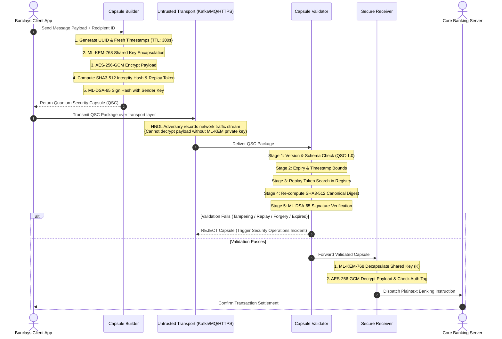

# Document 03

---

## 1. Complete System Architecture Diagram

```
===================================================================================
                       BARCLAYS QUANTUM SECURITY CAPSULE (QSC)
                                ARCHITECTURE OVERVIEW
===================================================================================

[ CLIENT / ORIGINATOR ]
  │
  ├──► [ 1. Payload Creation ] (Banking Payment / SWIFT Instruction / Payload / File)
  │
  ├──► [ 2. Capsule Builder ] ([builder.py](file:///c:/Users/hasan/antigravity/QSC/src/capsule/builder.py))
  │      │
  │      ├──► ML-KEM-768 Engine ([kem.py](file:///c:/Users/hasan/antigravity/QSC/src/crypto/kem.py))       ──► Encapsulate Symmetric Key (K)
  │      ├──► AES-256-GCM Engine ([symmetric.py](file:///c:/Users/hasan/antigravity/QSC/src/crypto/symmetric.py)) ──► Encrypt Payload with K
  │      ├──► SHA3-512 Engine ([hashing.py](file:///c:/Users/hasan/antigravity/QSC/src/crypto/hashing.py))     ──► Generate Integrity Hash & Replay Token
  │      └──► ML-DSA-65 Engine ([dsa.py](file:///c:/Users/hasan/antigravity/QSC/src/crypto/dsa.py))         ──► Sign Hash with Sender Private Key
  │
  └──► [ 3. Transmitted QSC Container ]
         │
         │  ( Transmitted across ANY Transport: HTTPS, Kafka, IBM MQ, SWIFT, .qsc Files )
         │
         ▼
[ UNTRUSTED NETWORK / HARVEST NOW DECRYPT LATER (HNDL) ADVERSARY ]
  │  - Payload Ciphertext: Unreadable without Recipient ML-KEM Private Key
  │  - Digital Signature: Unforgeable without Sender ML-DSA Private Key
  │  - Replay Token: Locked to specific timestamp window & unique ID
  │
  ▼
[ SERVER / RECEIVER NODE ]
  │
  ├──► [ 4. Capsule Validator ] ([validator.py](file:///c:/Users/hasan/antigravity/QSC/src/capsule/validator.py))
  │      │
  │      ├──► Gate 1: Version & Schema Verification (QSC-1.0)
  │      ├──► Gate 2: Timestamp Lifetime Check (Current Time <= ExpiresAt)
  │      ├──► Gate 3: Replay Registry Query (Check token in cache)
  │      ├──► Gate 4: Canonical SHA3-512 Integrity Digest Re-computation
  │      └──► Gate 5: ML-DSA-65 Signature Verification (Sender Public Key)
  │
  ├──► [ 5. Decryption Execution ] ([receiver.py](file:///c:/Users/hasan/antigravity/QSC/src/capsule/receiver.py))
  │      │
  │      ├──► ML-KEM-768 Decapsulate ─────► Recover Symmetric Key (K)
  │      └──► AES-256-GCM Decrypt ────────► Recover Plaintext Payload & Verify GCM Tag
  │
  └──► [ 6. Core Banking Engine ] (Executes Wire Settlement / Payment Processing)

===================================================================================
```

---

## 2. End-to-End Sequence Diagram (Mermaid)


